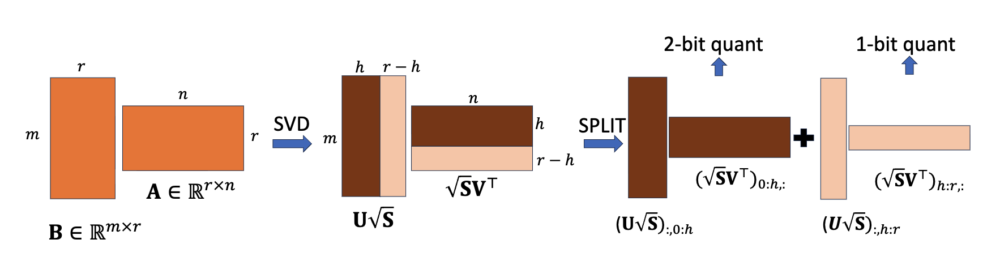

# LoRAQuant Reproduction Experiment

LoRAQuant is a mixed-precision quantization method applied to Low-Rank Adapters.

Paper: https://arxiv.org/abs/2510.26690v3

## Overview

Low rank adaptation is a parameter-efficient fine-tuning method. It allows for
tuning an additive set of model parameters for downstream tasks:

$$h = W_0x + \Delta Wx = W_0x + BAx $$

where $BA$ is a low rank matrix.

### LoRAQuant: Informed Quantization via Singular Values

LoRAQuant takes a LoRA adapter, splits it via SVD, then quantizes the factor
matrices using asymmetric quantization and 1-bit, binary quantization.



## Setup

Requires [uv](https://docs.astral.sh/uv/) and a CUDA GPU.

```bash
uv sync
export HF_TOKEN=<your token>    # your huggingface token
```

Get the adapter weights from the original repo
[here](https://github.com/MANGA-UOFA/LoRAQuant#download-weights).

## Evaluation Example

Evaluate LoRAQuant on GSM8K:

```bash
uv run lq --model=meta-llama/Llama-2-7b-hf \
  --adapter_path=weights/llama7b_metamath_lora16/checkpoint-24688 \
  --method=lq \
  --high_bits=3 \
  --ratio=0.7 \
  --opt
```

| Flag             | Options                    | Description                                                                   |
| ---------------- | -------------------------- | ----------------------------------------------------------------------------- |
| `--model`        | `meta-llama/Llama-2-7b-hf` | Base language model                                                           |
| `--method`       | `fp`, `rtn`, `bin`, `lq`   | Unquantized adapter, uniform RTN, uniform 1-bit, or LoRAQuant                 |
| `--high_bits`    | int ≥ 1                    | Bit width of the high-precision part (required for `rtn`, `lq`)               |
| `--ratio`        | float in (0, 1]            | ρ, the singular-value energy ratio that sets the high/low split (default 0.7) |
| `--opt`          | flag                       | Enable STE optimization (tune with `--opt_steps`, `--lr`; `lq` only)          |
| `--adapter_path` | directory                  | PEFT adapter directory (must contain `adapter_config.json`)                   |
| `--group_size`   | int > 0                    | Quantization group size; must divide the adapter dims (default 128)           |
| `--svd`          | `full`, `qr`               | SVD method for the split (default `full`, `lq` only)                          |
| `--limit`        | int > 0                    | Evaluate only the first N examples (quick smoke test)                         |
| `--res_path`     | directory                  | Results root directory (default `outputs`)                                    |

Results and other metrics are saved as JSON to
`<res_path>/<model>/<dataset>/<method>/`.

### Running tests

```bash
uv run pytest tests/
```
